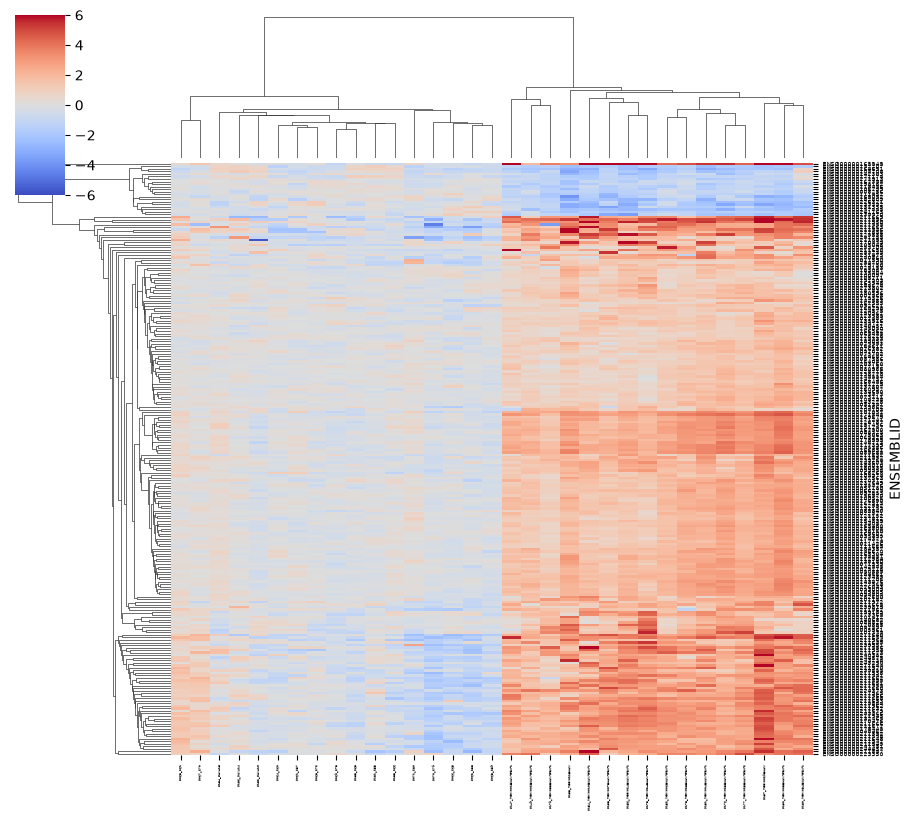
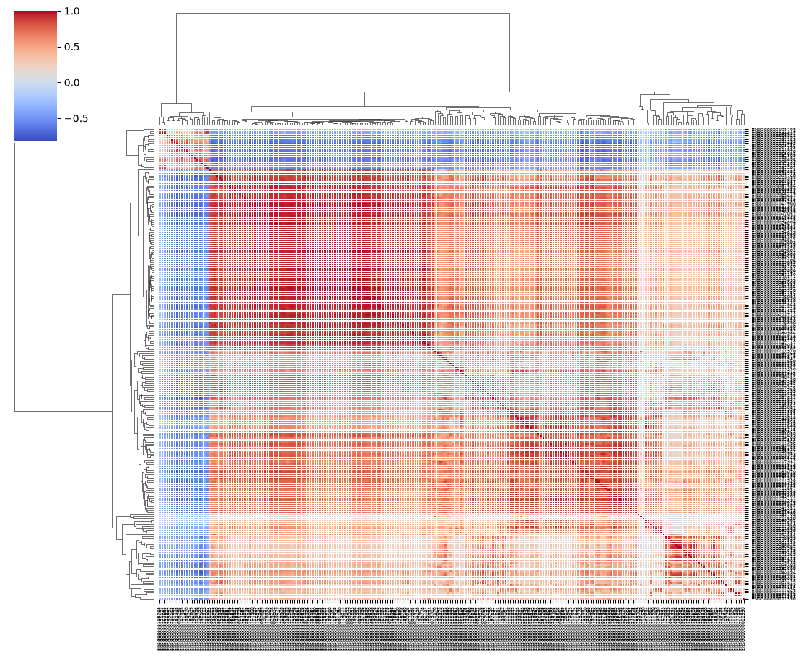
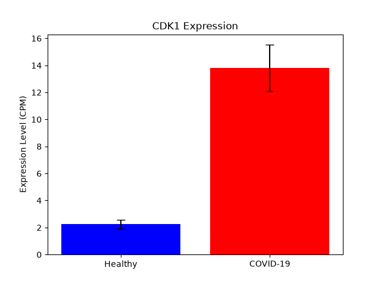
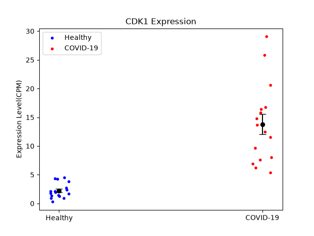

# COVID-19 RNA-Seq Differential Expression Analysis

A bioinformatic pipeline for differential gene expression analysis of COVID-19 patients versus healthy controls, starting from **raw RNA-Seq counts** and leading to biological pathway interpretation.

## Overview

This project investigates host transcriptional responses to SARS-CoV-2 infection using publicly available bulk RNA-Seq data. The primary objective is to identify Differentially Expressed Genes (DEGs) and uncover enriched biological pathways (such as immune response and cell cycle regulation) that characterize COVID-19 pathophysiology.

> **Note:** This project was developed as an independent learning initiative to apply statistical workflow principles learned in introductory bioinformatics to a novel raw count dataset.

## Dataset & Cohort Information

- **GEO Accession:** [GSE152418](https://www.ncbi.nlm.nih.gov/geo/query/acc.cgi?acc=GSE152418) (*Systems biological assessment of immunity to severe and mild COVID-19 infections*)
- **Data Type:** Raw RNA-Seq count matrix (60,683 Ensembl gene IDs across 34 samples)
- **Cohort Selection:**
  - **16** COVID-19 active disease samples
  - **17** Healthy control samples
  - *1 Convalescent sample was excluded* from the analysis to maintain clear contrast between active acute disease and healthy baselines.
  ## Analysis Workflow & Methodology

The analytical pipeline follows a structured, multi-step process from raw sequencing data to functional biology:
```
[Raw Counts: 60,683 genes]
        │
        ▼ (1. Low-Count Filtering: sum >= 10)
[37,107 genes]
        │
        ▼ (2. CPM Normalization)
[CPM Matrix]
        │
        ▼ (3. Expression Threshold: mean CPM >= 5 in >= 1 group)
[11,155 genes]
        │
        ▼ (4. Statistical Testing: 2-Sample KS Test & log2FC with pseudocount=1)
[p-values & Fold Changes]
        │
        ▼ (5. Multiple Testing Correction: Bonferroni)
[Adjusted p-values]
        │
        ▼ (6. DEG Selection: adj p <= 0.05 & |log2FC| >= 1)
[234 DEGs (214 Up, 20 Down)]
        │
        ▼ (7. Functional Enrichment & Mapping: mygene + Enrichr)
[Biological Pathways & Cell Cycle Insights]
```
### Key Methodological Decisions

1. **Low-Count Filtering:** Genes with total counts below 10 across all samples were removed to reduce baseline noise and technical artifacts from unexpressed genomic regions.
2. **CPM Normalization:** Counts Per Million (CPM) was calculated to adjust for differences in sequencing depth (library size) across individual samples, enabling valid cross-sample comparisons.
3. **Expression Filtering:** Keeping genes with a mean CPM $\ge 5$ in at least one experimental group ensured that downstream statistical testing focused on robustly expressed transcripts.
4. **Non-Parametric Testing (Kolmogorov-Smirnov Test):** The two-sample KS test was selected to evaluate differences in empirical cumulative distribution functions without making strict normality assumptions about expression levels.
5. **Fold-Change Calculation:** Log2 Fold Change ($log_2FC$) was computed between COVID-19 and Control group means using a pseudocount (+1) to prevent division by zero and handle low/zero expression values.
6. **Multiple Testing Correction (Bonferroni):** Applied to strictly control the Family-Wise Error Rate (FWER) given the thousands of simultaneous hypothesis tests being conducted.
## Results & Biological Interpretation

### Differentially Expressed Genes (DEGs) Summary
Using the primary cutoff thresholds (**Adjusted $p \le 0.05$** and **$\vert{}\log_2FC\vert{} \ge 1$**):
- **Total DEGs Identified:** 234 genes
- **Upregulated:** 214 genes
- **Downregulated:** 20 genes

> **Threshold Rationale:** Initial exploration with a stricter threshold ($\vert{}\log_2FC\vert{} \ge 2$) yielded 129 genes, all of which were upregulated. Relaxing the threshold to $\vert{}\log_2FC\vert{} \ge 1$ provided a more balanced and biologically comprehensive view of transcriptional alterations.

### Key Biological Insights & Pathway Enrichment

Enrichment analysis performed via **Enrichr** (after mapping Ensembl IDs to official Gene Symbols using `mygene`) revealed significant biological patterns:

1. **Immune & Humoral Response Activation:**
   - Top-ranked Reactome terms included **antibody-mediated complement activation**.
   - Significant overrepresentation of immunoglobulin genes (e.g., *IGHV*, *IGKV*, *IGLV*), reflecting robust activation of B-cell lineages and antibody production in response to SARS-CoV-2.

2. **Cell Cycle & DNA Replication:**
   - Highly significant enrichment across KEGG, BioPlanet, and WikiPathways for terms associated with **cell cycle progression** and **DNA replication**.

3. **Featured Biomarker Example — *CDK1*:**
   - **Cyclin Dependent Kinase 1 (*CDK1*)**, a key regulator of G2/M phase cell cycle transition, demonstrated a **~6-fold increase** in expression in COVID-19 patients compared to healthy controls (Mean: **~14 CPM** in COVID-19 vs. **~2 CPM** in Controls).
   ## Figures & Visualizations

The generated plots highlight sample-level expression profiles, DEG clustering, and gene-level expression differences:

| Per-Sample Log2 Expression Heatmap | DEG Correlation Heatmap |
| :---: | :---: |
|  |  |
| *Log2-transformed expression profiles across samples showing group-wise expression trends.* | *Pearson correlation analysis of DEGs showing distinct clustering between COVID-19 and Healthy Control samples.* |

| CDK1 Expression (Group Barplot) | CDK1 Expression (Per-Sample Scatterplot) |
| :---: | :---: |
|  |  |
| *Mean CPM expression of CDK1 comparing Healthy Controls vs. COVID-19 patients.* | *Individual sample-level CPM expression values for CDK1 across all analyzed samples.* |


## How to Run

### Prerequisites & Dependencies

Ensure Python 3.8+ is installed. The required packages can be installed via `pip`:

```bash
pip install pandas numpy scipy matplotlib seaborn mygene

```

### Execution Steps

1. **Download Data:** Download the raw counts matrix from GEO accession [GSE152418](https://www.ncbi.nlm.nih.gov/geo/query/acc.cgi?acc=GSE152418) (`GSE152418_raw_counts.csv.gz` or equivalent).
2. **Configure Path:** Update the local raw count file path near the top of `CovidData.py` to point to your downloaded file.
3. **Run Pipeline:**

```bash
python CovidData.py

```

> **Note:** An active internet connection is required during execution for live Ensembl-to-Symbol mapping via the `mygene` API.

## Limitations & Future Directions

* **Statistical Test Choice:** The Kolmogorov-Smirnov (KS) test with Bonferroni correction is a conservative, non-parametric approach suitable for learning. Industry standards for RNA-Seq count data rely on parametric negative binomial models implemented in specialized tools such as **DESeq2** or **edgeR**.
* **Statistical Power:** With a sample size of 16 vs. 17, power is limited, making fold-change and expression cutoffs somewhat heuristic.
* **Future Enhancements:**
* Transition the pipeline to use standard negative binomial models (e.g., via `PyDESeq2`).
* Implement dynamic command-line argument parsing (`argparse`) to eliminate hard-coded file paths.


```

```